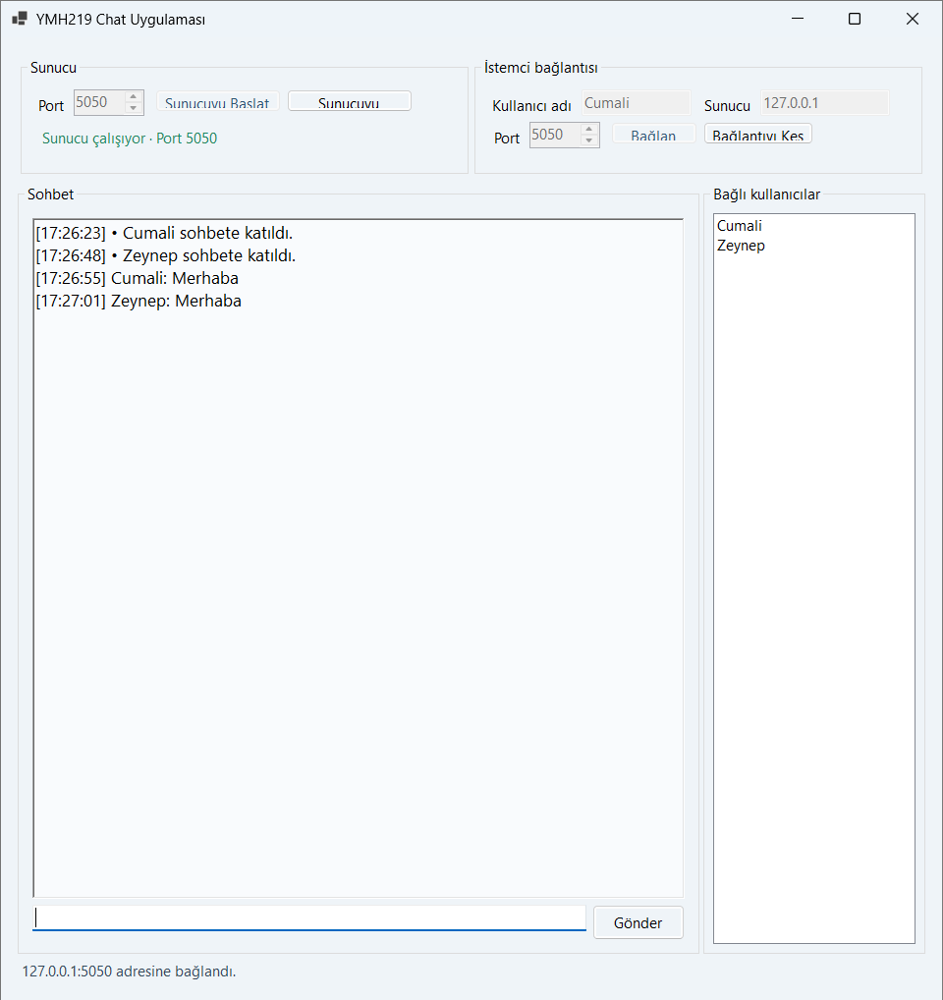
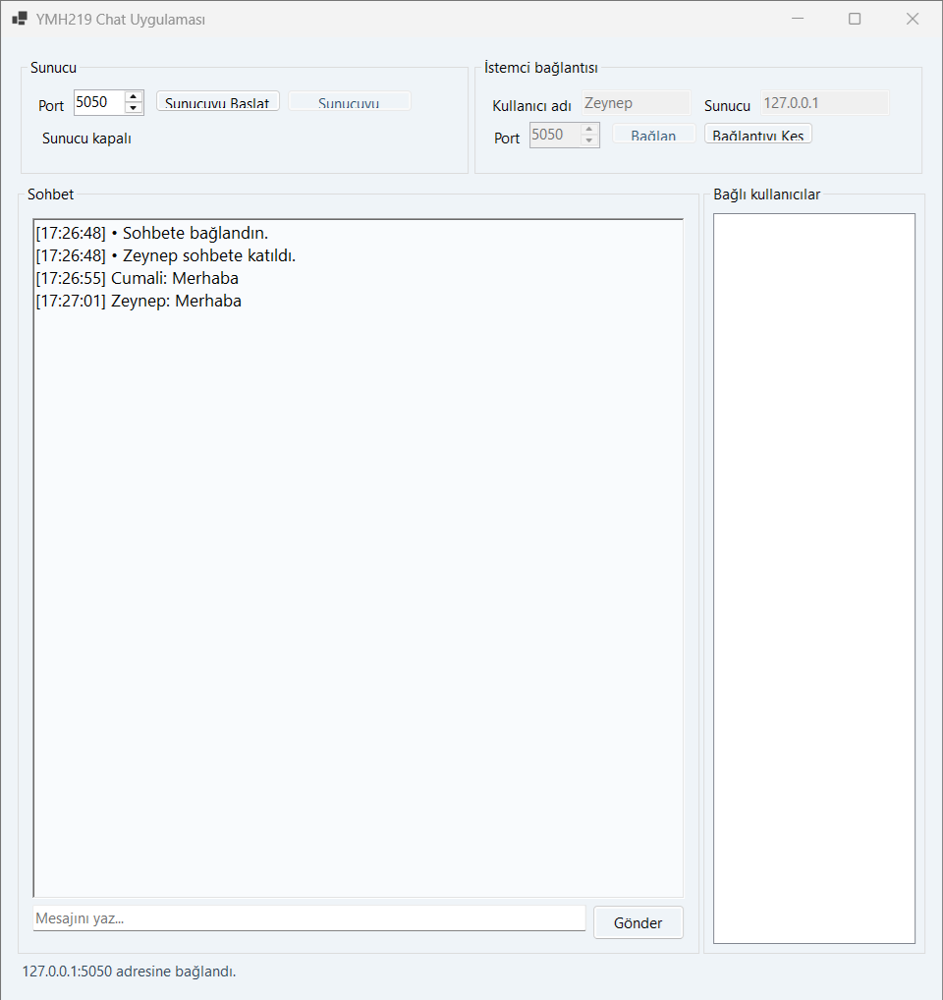

# YMH219 Chat Uygulaması

Nesne Tabanlı Programlama dersi için C# Windows Forms ile hazırlanmış, TCP/IP üzerinden yerel ağda mesajlaşma uygulaması. Aynı program hem sunucu hem istemci olarak çalışabilir; farklı bilgisayarlardaki örnekler aynı yerel ağda sunucu adresi ve portu üzerinden haberleşir.

## Özellikler

- Sunucu başlatma ve durdurma (`TcpListener`)
- Kullanıcı adıyla sunucuya bağlanma (`TcpClient`)
- Zaman damgalı mesaj gönderme ve alma
- Bağlanan kullanıcıları sunucu penceresinde listeleme
- Bağlan, mesaj gönder ve bağlantıyı kes kontrolleri
- Asenkron ağ işlemleri ve bağlantı hatalarında kullanıcı bildirimi
- JSON satır mesajlaşması, 24 karakter kullanıcı adı ve 2.000 karakter mesaj sınırı

## Teknolojiler

- C# / .NET 10
- Windows Forms
- TCP/IP
- Harici NuGet paketi yok

## Gereksinimler

- Windows 10 veya Windows 11
- .NET 10 SDK

## Çalıştırma

Depo klasöründe PowerShell açıp uygulamayı çalıştırın:

```powershell
dotnet run --project YMH219-ChatApp.csproj
```

Visual Studio'da `YMH219-ChatApp.csproj` dosyasını açıp **F5** tuşuna da basabilirsiniz.

## Yerel bilgisayarda deneme

1. Uygulamayı iki ayrı pencerede açın.
2. İlk pencerede **Sunucuyu Başlat** düğmesine basın. Varsayılan port `5050`'dir.
3. İkinci pencerede farklı bir kullanıcı adı girin, sunucu adresini `127.0.0.1` ve portu `5050` bırakın; **Bağlan**'a basın.
4. İki pencere arasında mesaj gönderin. Bağlı kullanıcı listesi sunucu penceresinde görünür.

Aynı yerel ağdaki başka bir bilgisayardan bağlanmak için sunucu bilgisayarının yerel IPv4 adresini kullanın. Windows Güvenlik Duvarı izin sorarsa yalnızca güvendiğiniz özel ağ için izin verin.

## Proje yapısı

- `ChatForm.cs` — arayüz, düğmeler ve UI olayları
- `ChatServer.cs` — TCP sunucusu, istemci oturumları ve yayın
- `ChatClient.cs` — sunucuya bağlanma, mesaj gönderme ve alma
- `ChatProtocol.cs` — istemci-sunucu JSON mesaj formatı

## Bilinen sınırlamalar

Bu, ders amaçlı yerel ağ uygulamasıdır. İletişim şifrelenmez; hassas veya özel mesajlar için kullanılmamalıdır. Kimlik doğrulama ve kalıcı sohbet geçmişi yoktur.

## Ekran görüntüleri

### Sunucu görünümü

Sunucu çalışırken bağlı kullanıcılar ve mesaj geçmişi.



### İstemci görünümü

Sunucuya bağlanan istemci ve karşılıklı mesajlaşma.



## Öğrenci bilgileri

- Ad Soyad: Cumali Bilgiç
- Öğrenci No: 250541008
